# Architecture and evidence contract

The runtime reads participant-facing data only. Public expected outputs are loaded exclusively by the evaluator.

```mermaid
flowchart LR
  A[CSV / JSON / SQL / logs / PDF / PNG] --> B[Shared evidence index]
  B --> C[Temporal identity associations]
  C --> D[Per-resource and replica timeline]
  D --> E[Runtime policy conditions]
  E --> F[Compliance gaps and uncertainty]
  F --> G[Flow and restore guards]
  G --> H[Ordered steps and evidence validation]
  H --> I[output.csv and diagnostics]
```

`model.Observation` contains system/resource/category, actual state, observation time, capture time, catalog-link availability time, nested values, matched identifiers, file provenance, confidence, ambiguity, source coverage, and physical location. JSON records retain nested payloads. Logs retain correlated request/readback fields and source line/trace provenance. PDFs retain all pages; screenshots retain words and coordinates in diagnostic artifacts.

`EvidenceIndex.ingest()` parses the manifest once. SQL executes in an in-memory SQLite database with an authorizer denying attachments, extension loading and unsupported pragmas, plus an instruction budget. Replica locations stay distinct. Row omission never proves absence. JSON supports snapshot bundles, typed records and service exports. Six log layouts are decoded into read correlations. PDFium extracts text and renders image-only pages for local OCR. Windows.Media.Ocr or Tesseract TSV supplies word coordinates. Cache keys depend on file bytes and extractor version, never labels or case IDs.

`IdentityGraph` builds current/historical email, phone, hash and stable-reference edges. It resolves the supplied email at request time, considers timely history, rejects ownership ambiguity and does not match names. Contradictory stable references take precedence over other tokens. Catalog associations are identity evidence, never operation-state proof. Associations created after artifact capture have their own availability gate.

`relationships.RelationshipIndex` traverses explicit typed same-subject record references. It rejects ambiguous system addresses and conflicting owners and never derives record state from an edge. `scope.Coverage` supports absence proofs for known resources only when completeness is explicitly declared and subject/category/location/time scope matches. Derived proofs are local to the case; auditing another request does not mutate the shared evidence index. The supplied `snapshot_scope` tables state covered systems and observation times, without declaring exhaustive coverage.

`AuditEngine.timeline()` accepts observations only when observation time, source capture and association availability are no later than audit_at. Workflow status and reported_result never establish resource state. The latest observation is selected per physical location; a dirty replica cannot be hidden by a clean primary. Simultaneous contradictions prevent COMPLETE. Historical retention metadata can persist, but old PII is never copied into the current record state.

`PolicyEngine` evaluates each CSV rule and supported condition at runtime. Unrecognized/unproven conditions become uncertainty. DELETE, REDACT, ANONYMIZE and RETAIN are separate targets. Tombstones may retain stable subject references; exposed direct identifiers still require redaction. Backups remain while unsafe restores are blocked. Explicit flow payloads containing only permitted retained references are allowed. Unknown enabled subject-scoped connectors are treated conservatively as risks; actual payload confirmation remains a limitation.

`dependencies.analyze_dependencies()` records explicit source-resource/reference edges and places flow-disable and restore-block guards before record treatment. Serialization follows public phase/operation/system/resource order. More complicated delete-after constraints are not silently substituted for that contract.

Uncertainty is not erased to maximize sample accuracy. Compatibility output maps unproven completeness to INCOMPLETE and writes diagnostics. Existing conditionally retained records receive only safe future presence checks while eligibility is reviewed. Such rows are not proven policy violations. `--strict` returns exit code 2 when unresolved cases remain. This dataset run fails that semantic gate. A missing required retained record is also unresolved because the public action vocabulary has no recovery operation.

Completeness additionally requires an associated account readback or an explicit deleted-account lifecycle marker; clean support/security observations alone do not establish account deletion. Callers with an explicitly complete subject inventory can state that input fact. Isolated unit fixtures enumerate that complete domain by construction; the production participant manifest does not. Unknown-policy cases with no justified actions may have an empty conservative plan; these are explicitly diagnosed and fail semantic acceptance rather than receiving fabricated actions.

Returned record data and request lookup context are separated. Whole-screen OCR remains provenance and is excluded from row identity matching. Generic message text and boolean contact-preference flags are not PII merely because they are nonempty. Prior proven business context can persist with provenance; historical PII does not persist into a cleared current record. An already-redacted/anonymized/deleted state may be verified without claiming a conditional rule applies, because no new retention permission or destructive operation is inferred. Identifiable security/hold records never receive this exemption.

The optional environment-configured generative fallback interprets ambiguous request intent only. It requires a boolean and exact supporting quote, validates schema/grounding, caches inputs and records actual provider/model/token usage. Model output never establishes resource state. No generative API is required for the default run.

`validate_output` checks schema, enums/states, numbering/order, coverage, evidence existence, observation/capture/association cutoff and cited observed state. `evaluation/main.py` measures public-sample accuracy. The independent artifact checker imports no inference module and checks outputs, dataset Git hashes, inference-source leakage and archive contents. Fixtures provide separate logical oracles and metamorphic checks. Automated artifact review does not replace an independent human/agent semantic review.
